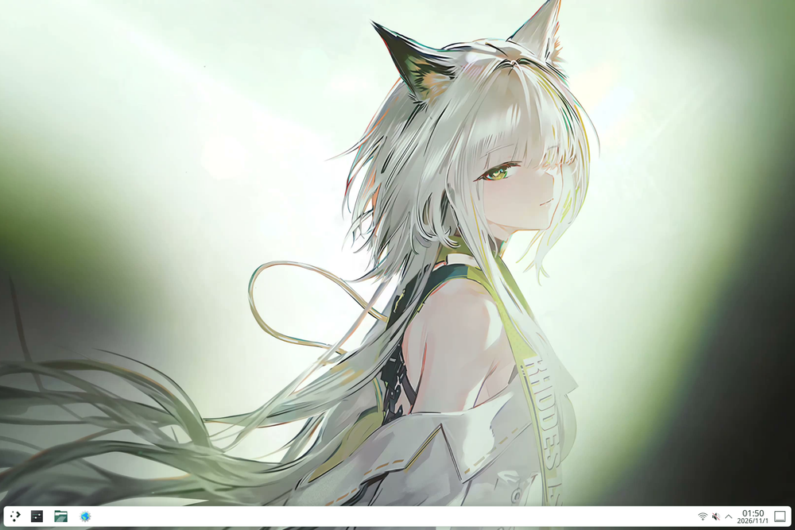
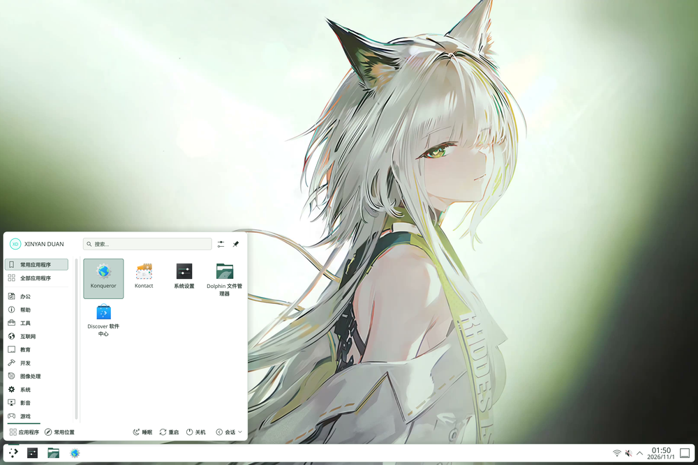
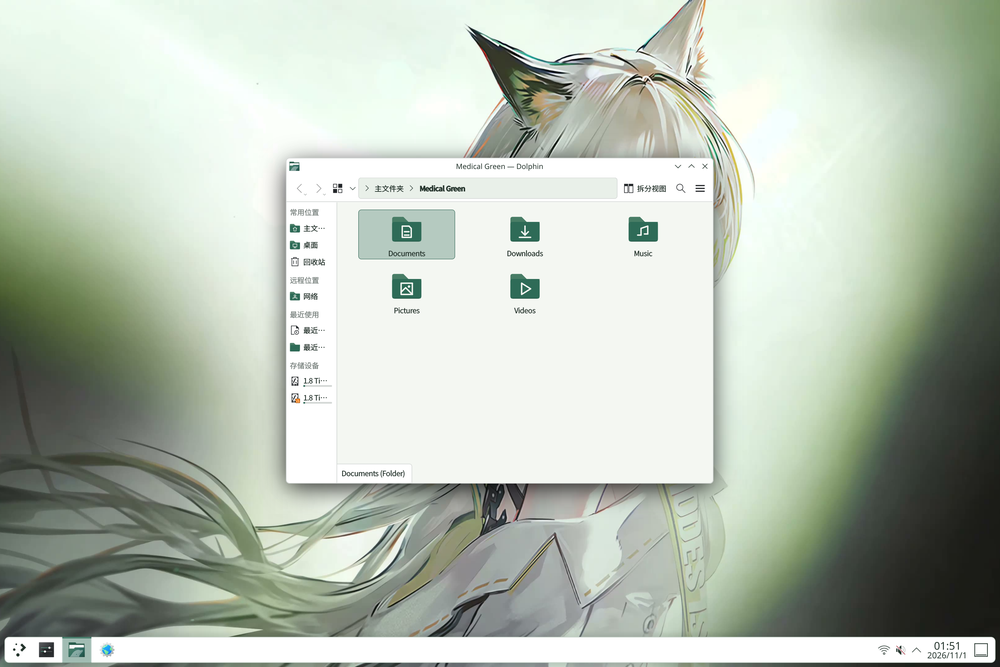
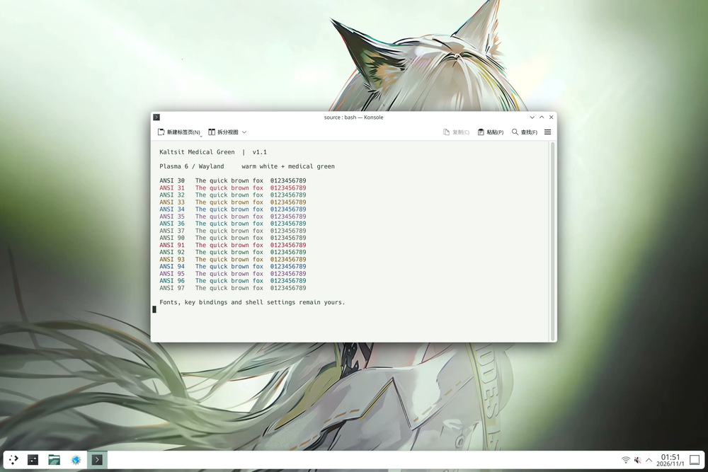
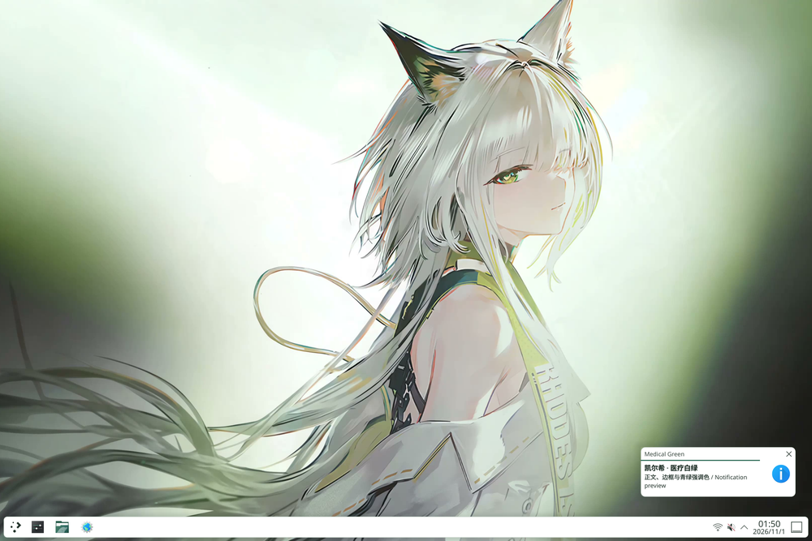
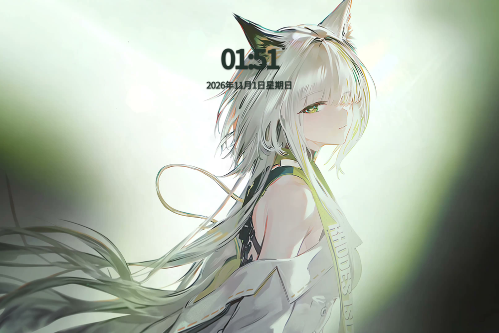
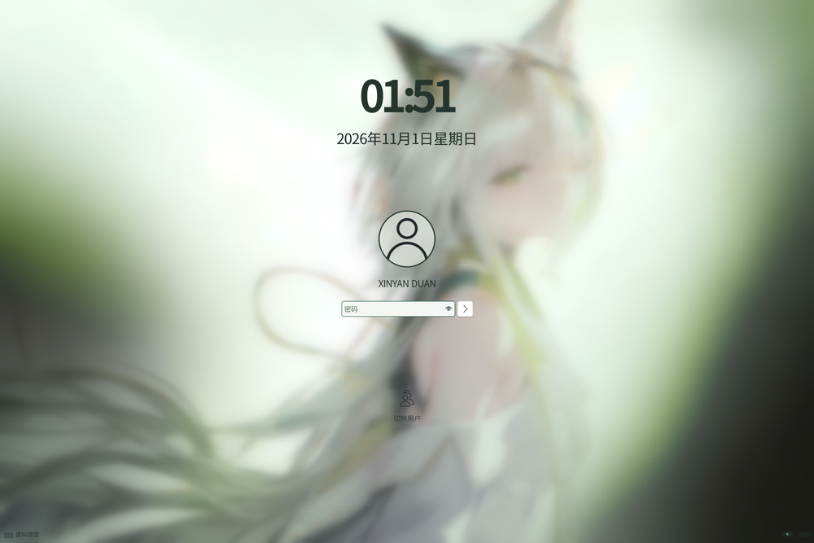

# Kal'tsit Medical Green

**Version 1.3.0 · A light theme for NixOS / KDE Plasma 6** · [中文](README.md)

Warm white backgrounds, dark green-gray text and teal accents, with Kal'tsit wallpaper, animated cursors and light terminals.
Switch explicitly after installation and restore your previous settings. Keep your panel layout, fonts, scale and cursor size.

v1.3 adds an optional [local video wallpaper](docs/MOTION.en.md): silent looping, right-click pause/resume and a still fallback when video is unavailable.
Install and select `kaltsit-motion` separately. Public source and release archives do not include a video; choose your own local file.
The v1.3 release uses the original lock screen and D1 desktop.
See the [v1.3 release evidence](docs/V1.3-RELEASE.md) and [GitHub Releases](https://github.com/JohnSmith-dink/kaltsit-medical-green/releases).

The development branch supports independent `programs.kaltsit-theme.motion.enable = true` with optional `videoFile` / `posterFile`. It installs resources only, defaults off, and never selects a wallpaper. See the [motion guide](docs/MOTION.en.md) for flake and matching `pkgs` examples.

[](previews/v1.2/actual/primary/desktop.png)

<details>
<summary>More native screenshots</summary>

[](previews/v1.2/actual/primary/launcher.png)

[](previews/v1.2/actual/primary/dolphin.png)

[](previews/v1.2/actual/primary/terminal.png)

[](previews/v1.2/actual/primary/notification.png)

[](previews/v1.2/actual/primary/lockscreen.png)

[](previews/v1.2/actual/primary/lockscreen-unlock.png)

</details>

These are the v1.2 original-lockscreen and D1 native isolated captures from source `9438a15`. Version 1.3 retains those visual resources. Static screenshots are not evidence of video playback.
Click thumbnails for originals. See the [two-resolution gallery](previews/v1.2/index.html) and [image provenance and hashes](previews/v1.2/manifest.json).
The user has accepted lockscreen brightness, password unlock, D1 appearance and mouse clicks on the physical machine; see [v1.2 release evidence](docs/V1.2-RELEASE.md) for scope.

## Install

For x86_64-linux / NixOS / Plasma 6. This round was validated on NixOS 26.05, Plasma 6.6.6 and Wayland.
Download the desired source version and run from its directory:

```sh
nix build --no-write-lock-file path:.#kaltsit-theme
nix profile install path:.#kaltsit-theme
kaltsit-theme status
```

Building and installing do not switch appearance. Install resources before apply so the existing Plasma process can discover them; applying through an uninstalled `nix run` package is not sufficient.
The complete Plasma shell resource layer must be built with the system's `pkgs` and rebuilt alongside Plasma upgrades. The standalone flake may lock a different KDE version; prefer the Home Manager integration below.
The complete package is marked `unfree` because assets have separate rights; see [credits and licenses](CREDITS.md).

## Switch and choose components

```sh
kaltsit-theme apply --dry-run
kaltsit-theme apply
kaltsit-theme status
kaltsit-theme restore

# Optional: skip components, or use one image for desktop and lockscreen
kaltsit-theme apply --skip cursor --skip gtk
kaltsit-theme apply --wallpaper /absolute/path/to/wallpaper.png
```

Restore an active application before changing options or versions. Repeating the same version and options does not replace the original backup.
`--dry-run` writes no configuration, backups or refresh notifications. Actual switching requires a logged-in KDE session.
`status` works offline, reporting installed/applied versions, effective colors and component state. New resource-version diagnostics are explained in [upgrade and recovery](docs/UPGRADE-RECOVERY.en.md).

| Component | Scope |
|---|---|
| `core` | Colors, Plasma style, widgets, window decoration and folder icons; required and cannot be skipped. |
| `cursor` | Animated cursors at 24 / 32 / 48 / 64 / 96px, preserving the chosen size. |
| `wallpaper` / `lockscreen` | Existing 4K frame 707, aspect-preserving crop; the Medical Green lock screen preserves wallpaper brightness and uses Plasma authentication. |
| `gtk` | Breeze GTK colors. |
| `ghostty` / `konsole` | Complete light ANSI palettes. |

The development branch uses the SDDM v6 left column for desktop lock and wake. The idle screen shows the time and date. Waking it reveals the avatar and password field in the same column. This layout applies when the Medical Green lock screen wallpaper is selected.

The logout, restart and shutdown prompts cover windows and desktop panels with the theme’s bundled lock screen wallpaper at its original brightness. They share the lock screen’s upper-left clock. The avatar, countdown and actions sit in a transparent left column that can scroll for long notices or extra actions. If you choose a custom lock screen wallpaper, the prompts still show the bundled wallpaper.

Repeat `--skip` as needed. Symlink-managed optional configuration skips the whole component and reports why; managed core configuration stops apply before writes.
Missing lockscreen resources remain an explicit error with zero writes; use `--skip lockscreen` deliberately when needed. Check individual component results: a successful exit does not mean every component was applied.
The base theme package does not include SDDM; see the separate optional login theme below. Plymouth, boot menus and application-specific custom skins remain outside the scope.

## Login screen (SDDM, experimental)

The development branch adds a separate `kaltsit-sddm` package and NixOS module, disabled by default. It loaded and completed password login and return from logout in a 1280×800 X11 test VM using NixOS 26.05 / SDDM 0.21.0 / Qt 6.11.2. The test session was xterm; physical hardware remains unverified.
It uses the existing static wallpaper; installation does not enable the SDDM service. See the [SDDM guide](docs/SDDM.en.md) for installation, VM checks, the future build-then-boot sequence on physical hardware, and recovery.

## Home Manager

```nix
{ ... }: {
  imports = [ ./path/to/kaltsit-medical-green/home-manager.nix ];
  programs.kaltsit-theme.enable = true;
}
```

The module is off by default and reuses the caller's `pkgs`, which must allow the `kaltsit-theme` unfree package. It installs resources and Breeze GTK without activation switching.
Override `programs.kaltsit-theme.package` if needed. If Home Manager already installs the theme, update that source rather than adding a profile copy.
No Stylix or plasma-manager is required. The legacy `nix-build` entry uses local `<nixpkgs>`.

For declaratively managed Ghostty, install the theme file and choose it explicitly:

```nix
programs.kaltsit-theme.ghosttyThemeFile = true;
programs.ghostty.settings.theme = "Kaltsit Medical Green";
```

`ghosttyThemeFile` defaults to false and requires the theme module to be enabled. It does not itself edit Ghostty configuration; declarative selection can be combined with `--skip ghostty`.

## Upgrade, restore and remove

Restore before upgrading or removing resources. Unrelated later edits survive; same-key conflicts are reported and backups retained.
`${XDG_STATE_HOME:-$HOME/.local/state}/kaltsit-theme/active.json` contains personal configuration. Do not publish or prematurely delete it.
See the [upgrade and recovery guide](docs/UPGRADE-RECOVERY.en.md) for full steps, TTY recovery, Plasma diagnostics and legacy state compatibility.

## Credits and development

Cursors are pinned to [kaltsit-cursors / 7ef139a](https://github.com/JohnSmith-dink/kaltsit-cursors/tree/7ef139a6210fd8eb03d0296b624d71eaa3120589), retaining 17 Xcursor files, 68 upstream aliases and 8 compatibility aliases.
Original artist: [一球咸鱼](https://space.bilibili.com/3585839); [artist video](https://b23.tv/zHvHCpF) / [original work](https://www.bilibili.com/video/BV1L5Vq6vEaX/).
The 32px artwork uses nearest-neighbor scaling for additional sizes. Wallpaper preserves the original JPEG for frame 707 and excludes the source video.
Original code, Plasma SVGs and folders use MIT; derived KDE QML uses GPL-2.0-or-later, while character imagery and cursors have separate rights.
See [CREDITS](CREDITS.md), [wallpaper provenance](docs/asset-provenance.json) and [cursor provenance](docs/cursor-source.json).

```sh
nix develop --no-update-lock-file --command python3 -m unittest discover -s tests -v
nix flake check --no-update-lock-file --print-build-logs
# Only when maintaining derived assets
nix develop --no-update-lock-file --command python3 scripts/generate-assets.py
nix develop --no-update-lock-file --command python3 scripts/generate-thumbnails.py
```

The weekly workflow checks locked dependencies and probes unstable independently. Failures stay visible; it neither updates the lock file nor opens automatic PRs.
Isolated previews do not certify real authentication, multiple monitors or all cursor sizes on physical screens.
[v1.2 release evidence](docs/V1.2-RELEASE.md) · [Development history](docs/V1.2-DEVELOPMENT.md) · [Changelog](CHANGELOG.md) · [Prerelease history](docs/HISTORY.md) · [v1.1 validation](docs/VALIDATION.md) · [v1.1 release record](docs/RELEASE-READINESS.md)
