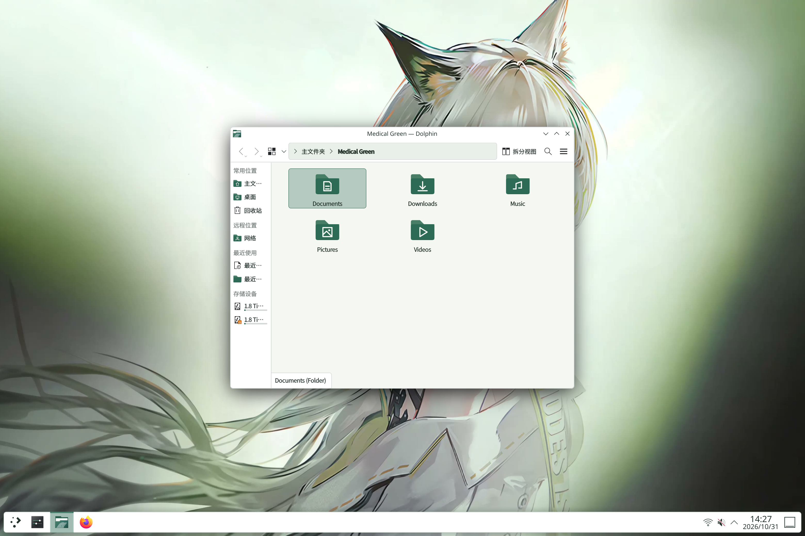

# 凯尔希 · 医疗白绿

**Kal'tsit Medical Green 1.1.0 · 克制日常**

[English](README.en.md)

v1.1 正式版沿用已验收的 rc.3 锁屏：移除全部壁纸遮罩，并停用本主题密码页的亮度、对比度和饱和度变换。
原始 JPEG 字节保持，继续使用原生模糊、认证、输入框和焦点行为；锁屏控件恢复浅底深字。桌面仍为浅色白绿配色。
rc.3 已通过构建、隔离回归与 NixOS generation 54 实机验收，用户确认“亮度正常，解锁正常”。正式版仅更新版本与文档，运行资源保持不变。[正式版发布记录](docs/RELEASE-READINESS.md)。

适用于 NixOS / KDE Plasma 6 的浅色主题：暖白 `#F4F7F2`、白色面板、
深灰绿正文 `#25352D`、青绿强调色 `#2E6B57`。轻边框与柔和阴影覆盖面板和弹窗，
其余 Plasma 元素回退到 Breeze；Dolphin、系统设置和窗口装饰保留原生控件。
终端保持浅色，安装后需要主动切换。



上图来自本机独立 KWin/Plasma 会话中的真实应用。正式版沿用 rc.3 的十张原始预览，没有重新拍摄；截图版本与渲染后端以预览清单为准。
完整的桌面、菜单、Dolphin、终端、通知与锁屏画面见 [预览说明](previews/README.md)
或本地打开 [预览画廊](previews/index.html)。日常物理屏幕上的锁屏亮度与解锁已由用户确认。

## 安装与切换

这是 **v1.1.0 正式版**。已验证环境为
x86_64-linux、NixOS 26.05、Plasma 6.6.6 / Wayland；复用现有 `flake.lock`。
主题素材含单独权利范围，完整包标记为 `unfree`，见 [CREDITS.md](CREDITS.md)。

在本版本源码目录中：

```sh
# 构建与安装均不切换外观
nix build --no-write-lock-file path:.#kaltsit-theme
nix profile install path:.#kaltsit-theme
kaltsit-theme status
```

如果已经通过 Home Manager 安装，应更新其包来源，避免同时安装两份同名包。
**先安装资源，再应用**：已经运行的 Plasma 要能从用户/系统数据目录发现新样式；
仅用未安装的 `nix run` 执行 apply 不保证已有进程能找到它。

本版本的构建产物包含完整 Plasma shell 资源层，会参与 shell 包发现。请使用与系统相同的 `pkgs` 构建，
并在 Plasma 升级时重建主题；固定旧 flake 的主题包可能遮住新版 shell。Home Manager 模块默认复用调用者的 `pkgs`。

```sh
# 已应用旧版本时先恢复。失败或冲突时先处理输出，不要删除恢复记录。
kaltsit-theme restore
kaltsit-theme apply
kaltsit-theme status

# 返回应用前状态
kaltsit-theme restore
```

首次使用可直接 `apply`。相同版本、相同选项的重复应用不覆盖备份；旧版本处于 active 状态，
或需要改变组件选择、壁纸时，先 restore 再 apply。`status` 可在没有 Plasma 会话时读取记录，
显示安装版本、应用版本、当前 Plasma 样式及各组件的应用或跳过状态。
主题也能在 KDE 全局主题列表中发现，但完整切换请用命令，以覆盖终端等附加设置。

## 预演与可选组件

```sh
# 只读取配置和会话状态，列出组件、跳过原因及拟修改的值
kaltsit-theme apply --dry-run

# 可多次传入 --skip；core 是必需组件，不能跳过
kaltsit-theme apply --skip cursor --skip gtk

# 自选图片同时用于桌面和锁屏，保持比例、居中裁切
kaltsit-theme apply --wallpaper /absolute/path/to/wallpaper.png
```

组件为 `core`、`cursor`、`wallpaper`、`lockscreen`、`gtk`、`ghostty` 和 `konsole`。
`core` 包含配色、Plasma 样式、控件、窗口装饰和图标。其配置若由符号链接管理，
整个 apply 在修改前拒绝执行；可选组件的目标配置为符号链接时，跳过整个组件并说明原因。
手动 `--skip` 与自动跳过都会记录，其他组件继续应用；成功退出不表示所有组件均已应用，
请查看返回结果或 `status`。`--skip` 名称和自选图片会在修改前校验。

`--dry-run` 不创建备份目录、不写配置、不切换主题，也不发送刷新通知。
实际 apply 按启用组件检查所需命令；优先使用当前 PATH 中的系统工具，打包工具作为后备。
真正修改桌面仍需处于已登录的 KDE Plasma 会话。

## Home Manager

将源码纳入自己的配置，然后导入模块：

```nix
{ ... }: {
  imports = [ ./path/to/kaltsit-medical-green/home-manager.nix ];
  programs.kaltsit-theme.enable = true;
}
```

模块复用调用者的 `pkgs`，允许 `kaltsit-theme` 的 unfree 标记后即可构建；也可用
`programs.kaltsit-theme.package` 指定 flake 的 `packages.x86_64-linux.kaltsit-theme`。
模块默认关闭，只安装主题与 Breeze GTK，不包含 activation 切换命令。
无需 Stylix 或 plasma-manager。旧式入口 `nix-build` 使用本机 `<nixpkgs>`。

Ghostty 配置由 Home Manager 管理时，可只安装主题文件并声明选择：

```nix
{
  programs.kaltsit-theme.enable = true;
  programs.kaltsit-theme.ghosttyThemeFile = true;
  programs.ghostty.settings.theme = "Kaltsit Medical Green";
}
```

`ghosttyThemeFile` 默认为 `false`；启用主题模块后，设为 `true` 会安装
`$XDG_CONFIG_HOME/ghostty/themes/Kaltsit Medical Green`，本选项不修改 Ghostty 配置。
使用声明式主题设置时，切换命令可显式传入 `--skip ghostty`。

## 覆盖与恢复

- 桌面、原生启动菜单、通知、面板，以及窗口、Dolphin 和系统设置的统一配色。
- 30 种文件夹名称，分别绘制 16 / 22 / 32px 与可缩放版本，应用图标继承 Breeze。
- 24 / 32 / 48 / 64 / 96px 动态指针，保留 `Kaltsit-Sihengtu` 标识、动画、热点与用户尺寸。
- 第 707 帧原始静帧用于桌面和锁屏，按比例裁切；原生锁屏认证行为不变。
- Ghostty、Konsole 的完整浅色 ANSI 配色；GTK 通过 Breeze GTK 跟随系统。

切换工具通过 KDE 命令修改配置键，备份新增 Plasma 样式键并按键恢复。
不重置面板位置、固定应用、桌面图标，不修改字体、缩放、命令行 Shell 或快捷键。
失败时尝试恢复本次修改；恢复时保留之后添加的无关设置。
用户后来改动同一个主题键时会报告冲突并保留该值和备份，解决冲突后可再次 restore。
备份位于 `${XDG_STATE_HOME:-$HOME/.local/state}/kaltsit-theme/active.json`，不打包上传。

若用户目录存在同名旧指针（`~/.icons` 或 XDG 用户图标目录），apply 会将其原样移入
私有备份目录，再链接至已安装的新资源；restore 会还原原目录或原链接。
这避免旧 32px 副本遮盖 Nix 的多尺寸版本。同名主题会重新加载动画，尺寸设置保持不变。
恢复记录格式升级为 3，记录实际应用的组件与跳过原因；只恢复已应用组件。
仍能读取格式 1 和格式 2 的完整主题记录，并保留格式 2 的指针目录备份。
降级安装前必须用当前工具执行 restore，旧版工具会拒绝新记录。
旧 Ghostty 备份引用的 Nix 路径已被回收，也不妨碍清理本工具的配置块和恢复原配置；
恢复配置不等于重新下载已经丢失的旧资源。

声明式用户可自行引用素材并跳过相关组件，或让相关键由 KDE 管理。
SDDM、Plymouth、引导界面与浏览器专属皮肤不在本版范围；独立绘制界面的应用可能保留自己的样式。

## 指针与素材来源

指针固定为 [kaltsit-cursors 的 7ef139a](https://github.com/JohnSmith-dink/kaltsit-cursors/tree/7ef139a6210fd8eb03d0296b624d71eaa3120589)。
17 个 Xcursor 文件及上游 68 个别名原样纳入，并补留 v1.0 的 8 个兼容别名。
原画为 32px 像素画，多尺寸采用上游最近邻缩放，未声称新增高清原画。
原作者：[一球咸鱼](https://space.bilibili.com/3585839)；
作者视频：[b23.tv/zHvHCpF](https://b23.tv/zHvHCpF)；
原作品：[凯尔希 · 思衡托](https://www.bilibili.com/video/BV1L5Vq6vEaX/)。
文件哈希、别名和固定提交见 [cursor-source.json](docs/cursor-source.json)。

壁纸为既有 4K VBG 的第 707 帧原始 JPEG，3840×2160，不附带整段视频。
3120×2080 屏幕按 3:2 居中裁切，相当于原图左右各裁 300px，人物面部保留、比例不变。
详情见 [素材记录](docs/asset-provenance.json)。原创代码、Plasma SVG 与文件夹使用 MIT；
KDE 上游派生 QML、角色图像和指针另有许可范围，见 [CREDITS.md](CREDITS.md)。

## 锁屏效果与兼容性

正式版沿用 rc.3 的锁屏处理：
壁纸插件不叠加遮罩；仅当 Fader 的 `source.pluginName` 为本主题锁屏插件时，
将 contrast、saturation、intensity 三个颜色变换系数固定为 1。原生模糊保留，其他壁纸插件沿用 KDE 的颜色变换。
Complementary 配色恢复浅底深字，让时钟与输入控件在原图上清楚可读；这不会恢复壁纸提亮。

此版涉及 Plasma shell QML 的构建适配。Nix 从匹配的 KDE 依赖生成局部 QML 差异，
未改动的上游文件在构建时逐字节复制至产物，仓库不维护独立的认证源码分支。
构建通过精确片段匹配检查上游源码；预期结构变化时停止构建，需先核对兼容性。细节见 [验收记录](docs/VALIDATION.md)。
生成的上游派生 QML 保留 GPL-2.0-or-later 许可，主题的 MIT 许可不涵盖这些文件。

## 开发验证

```sh
python3 scripts/generate-assets.py
nix develop --command python3 -m unittest discover -s tests -v
nix flake check --no-write-lock-file path:.
```

正式版的运行资源与 rc.3 保持一致，仅版本和文档更新。rc.3 的 69 项测试、离线 Nix 构建和 `flake check` 已通过，
包括资源预检、资源缺失时零配置写入，以及显式跳过锁屏后的应用与恢复。
3120×2080 / 175% RHI 与 1920×1080 / 100% 软件后端的完整隔离回归均通过；预览沿用该轮十张截图。
rc.3 已实装至 NixOS generation 54，用户确认“亮度正常，解锁正常”。此前的应用、重复应用、恢复、失败回滚与升级记录见 [验收记录](docs/VALIDATION.md)。
五档指针已完成自动检查，尚未逐档实屏核验；本轮未接入外接显示器。
既有 libXcursor 检查成功加载 85 组指针/尺寸；本轮资源未变，重新核对哈希、动画与热点。
现有桌面正文对比度约 11.95:1；rc.2 的 KDE 全部前景色在本组常规及交替背景上最低 4.56:1。
ANSI 普通/Intense 最低 5.58:1，Faint 最低 4.51:1。
检查范围与运行方式见 [验收记录](docs/VALIDATION.md)。
rc.3 提交 `d5dfb24` 的两项托管 CI 均已通过。正式版发布构建与 CI 结果另见仓库 Actions；历史结果不标作正式版新构建的通过记录。
