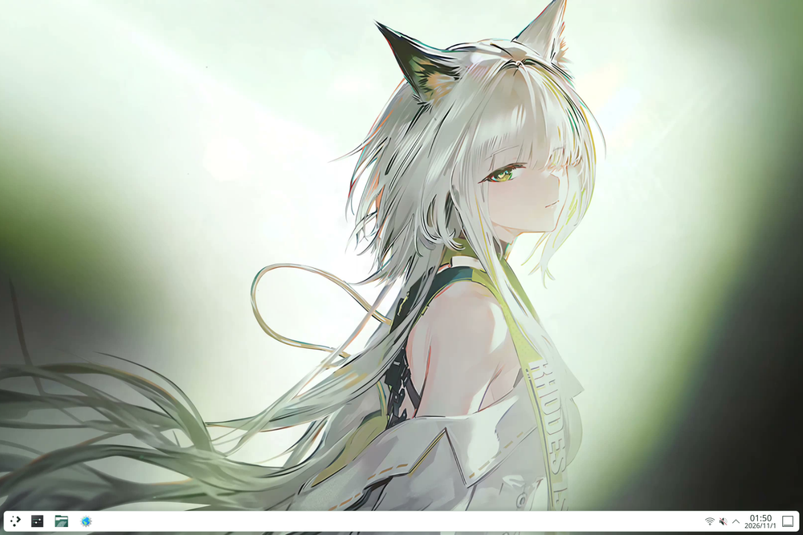
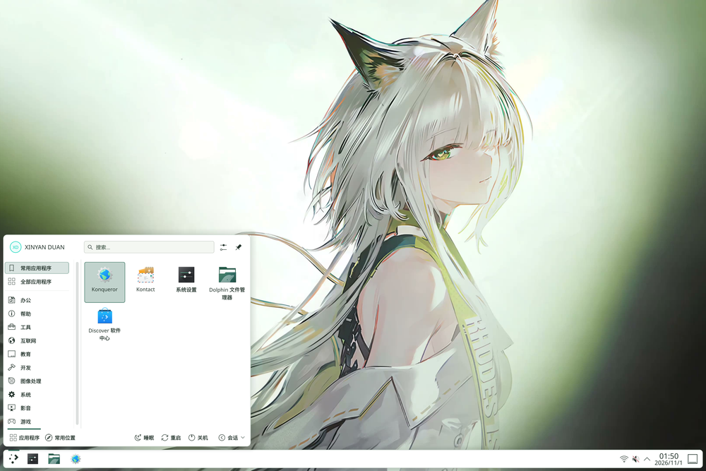
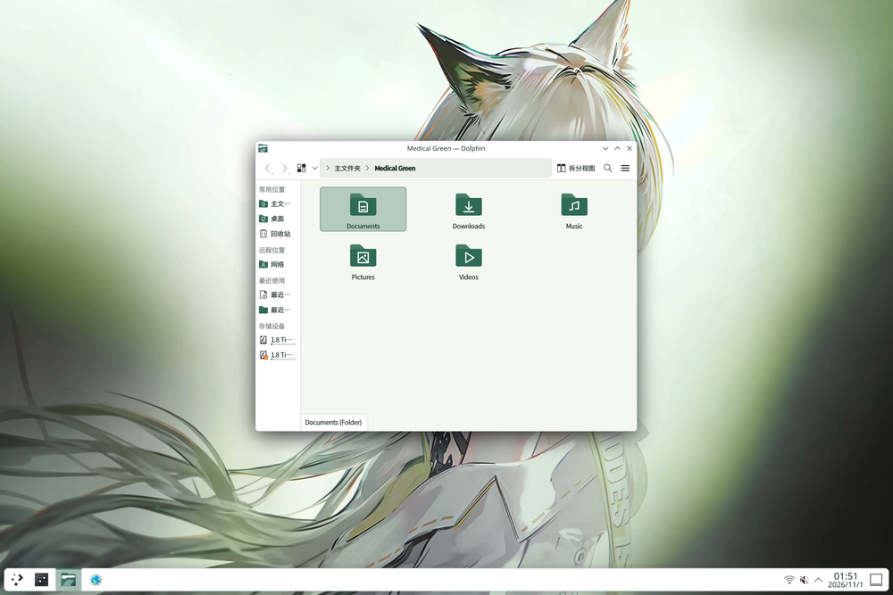
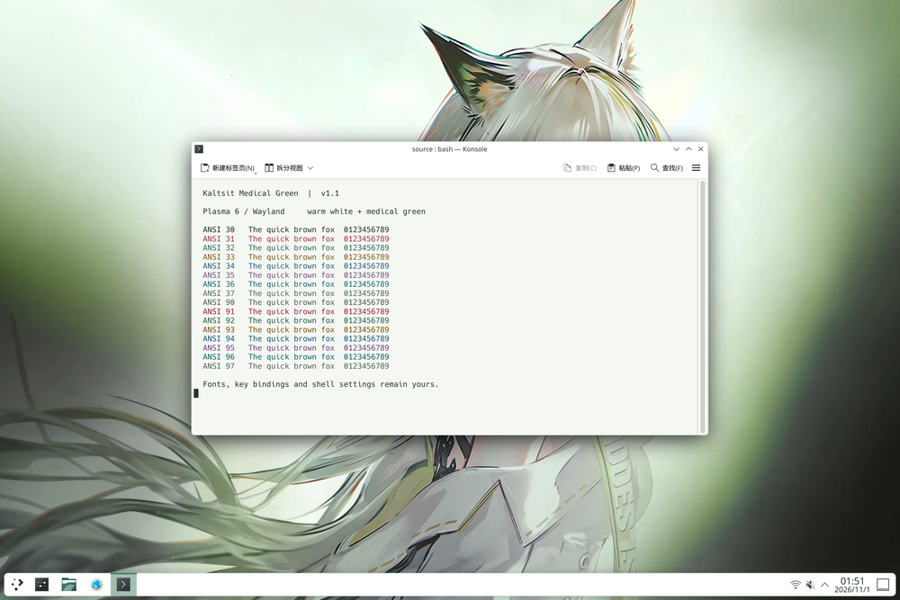
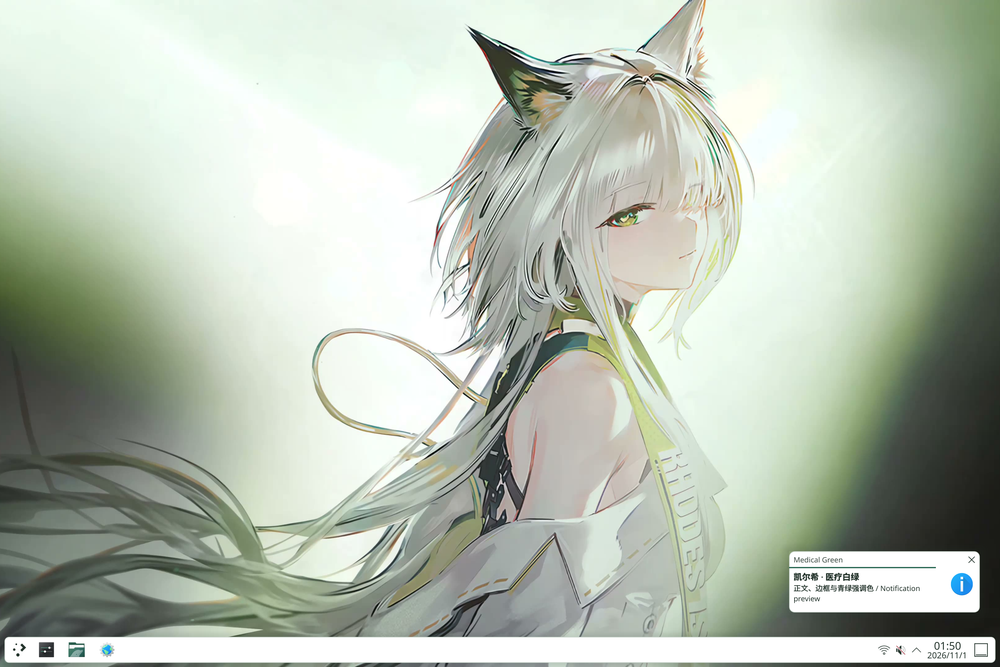
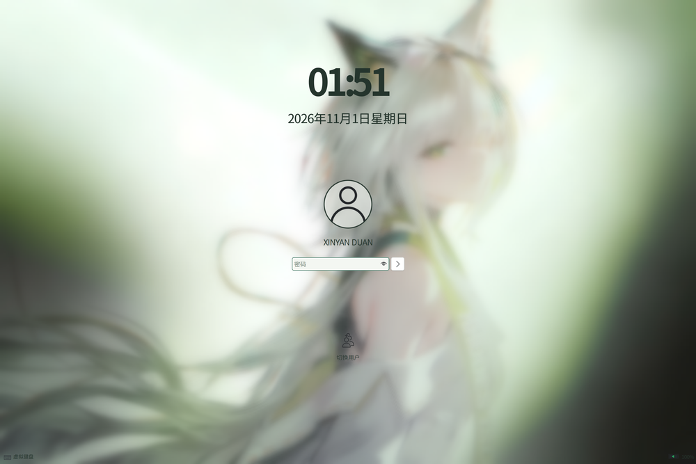

# 凯尔希 · 医疗白绿

**Kal'tsit Medical Green 1.2.0 · NixOS / KDE Plasma 6 浅色主题** · [English](README.en.md)

暖白背景、深灰绿正文、青绿强调色，配合凯尔希壁纸、动态指针与浅色终端。
安装后主动切换，可恢复之前的设置；面板布局、字体、缩放和指针尺寸继续使用你的选择。

v1.2 保留原版锁屏，桌面采用 D1：面板圆角 8、弹窗 10、提示框 6，阴影不透明度 0.12。
保留你的面板高度、位置和组件顺序；本轮实机验收使用 46 逻辑像素底栏。
新增只读 Plasma 版本诊断，并完善配置恢复、使用文档和每周兼容性检查。
发布状态见 [GitHub Releases](https://github.com/JohnSmith-dink/kaltsit-medical-green/releases)。

[](previews/v1.2/actual/primary/desktop.png)

<details>
<summary>更多原生截图</summary>

[](previews/v1.2/actual/primary/launcher.png)

[](previews/v1.2/actual/primary/dolphin.png)

[](previews/v1.2/actual/primary/terminal.png)

[](previews/v1.2/actual/primary/notification.png)

[](previews/v1.2/actual/primary/lockscreen.png)

[](previews/v1.2/actual/primary/lockscreen-unlock.png)

</details>

以上为已验收开发源码 `9438a15` 的原生 KDE 隔离截图；1.2.0 沿用其运行逻辑与外观，仅更新版本标识和发布文档。
点击缩略图查看原图；[双分辨率画廊](previews/v1.2/index.html)与[来源及哈希](previews/v1.2/manifest.json)分别记录原图和缩略图。
原版锁屏亮度、密码解锁、D1 观感与鼠标点击已通过本机用户验收；范围见 [v1.2 发布依据](docs/V1.2-RELEASE.md)。

## 安装

支持 x86_64-linux / NixOS / Plasma 6；本轮已验证 NixOS 26.05、Plasma 6.6.6、Wayland。
下载需要的版本源码后，在其目录运行：

```sh
nix build --no-write-lock-file path:.#kaltsit-theme
nix profile install path:.#kaltsit-theme
kaltsit-theme status
```

构建与安装不切换外观。先安装资源再 apply，已有 Plasma 进程才能发现新样式；仅用未安装的 `nix run` 执行 apply 不保证可用。
主题包含完整 Plasma shell 资源层，必须与系统使用同一套 `pkgs` 构建，并随 Plasma 升级重建。独立 flake 的锁定版本可能不同，优先使用下面的 Home Manager 集成。
完整包因素材权利范围标记为 `unfree`，详见 [署名与许可](CREDITS.md)。

## 切换与组件

```sh
kaltsit-theme apply --dry-run
kaltsit-theme apply
kaltsit-theme status
kaltsit-theme restore

# 可选：跳过组件，或自选桌面与锁屏共用壁纸
kaltsit-theme apply --skip cursor --skip gtk
kaltsit-theme apply --wallpaper /absolute/path/to/wallpaper.png
```

有活动恢复记录时，改变选项或版本前先 restore。相同版本、相同选项重复 apply 不覆盖最初备份。
`--dry-run` 不写配置、备份或刷新通知；实际切换需在已登录的 KDE 会话执行。
`status` 离线仍可用，显示安装/应用版本、实际配色与组件状态；新版本诊断字段见 [升级与恢复](docs/UPGRADE-RECOVERY.md)。

| 组件 | 覆盖范围 |
|---|---|
| `core` | 配色、Plasma 样式、控件、窗口装饰与文件夹图标；必需，不能跳过。 |
| `cursor` | 24 / 32 / 48 / 64 / 96px 动态指针，保留原尺寸选择。 |
| `wallpaper` / `lockscreen` | 既有 4K 第 707 帧，保持比例裁切；锁屏无额外提亮、压暗或遮罩，保留原生模糊与认证。 |
| `gtk` | Breeze GTK 配色。 |
| `ghostty` / `konsole` | 完整浅色 ANSI 配色。 |

`--skip` 可重复。可选组件的配置由符号链接管理时，会跳过整个组件并报告；核心配置受管理时，在写入前停止。
缺失锁屏资源会明确报错并保持零写入；需要跳过时显式使用 `--skip lockscreen`。请检查每个组件的结果，成功退出不等于全部已应用。
SDDM、Plymouth、引导菜单与应用自绘皮肤不在范围内。

## Home Manager

```nix
{ ... }: {
  imports = [ ./path/to/kaltsit-medical-green/home-manager.nix ];
  programs.kaltsit-theme.enable = true;
}
```

模块默认关闭，复用调用者的 `pkgs`；允许 `kaltsit-theme` 的 unfree 标记后构建，只安装资源与 Breeze GTK，不自动切换。
可通过 `programs.kaltsit-theme.package` 指定包。已用 Home Manager 安装时，应更新该来源，避免另装一份 profile 包。
无需 Stylix 或 plasma-manager；旧式 `nix-build` 入口使用本机 `<nixpkgs>`。

Ghostty 由 Home Manager 管理时，可安装主题文件并声明选择：

```nix
programs.kaltsit-theme.ghosttyThemeFile = true;
programs.ghostty.settings.theme = "Kaltsit Medical Green";
```

`ghosttyThemeFile` 默认为 false，启用主题模块后生效；它本身不修改 Ghostty 配置。声明式设置可配合 `--skip ghostty`。

## 升级、恢复与卸载

先 restore，再更新或卸载。恢复保留无关后改设置，同键冲突会报告并保留备份。
备份 `${XDG_STATE_HOME:-$HOME/.local/state}/kaltsit-theme/active.json` 含个人配置，请勿公开或提前删除。
完整步骤、TTY 应急说明、Plasma 版本诊断与旧记录兼容性见 [升级与恢复指南](docs/UPGRADE-RECOVERY.md)。

## 署名与开发

指针来源固定为 [kaltsit-cursors / 7ef139a](https://github.com/JohnSmith-dink/kaltsit-cursors/tree/7ef139a6210fd8eb03d0296b624d71eaa3120589)，
保留 17 个 Xcursor、68 个上游别名和 8 个兼容别名。原作者 [一球咸鱼](https://space.bilibili.com/3585839)，
[作者视频](https://b23.tv/zHvHCpF) / [原作品《凯尔希 · 思衡托》](https://www.bilibili.com/video/BV1L5Vq6vEaX/)。
32px 原画的多尺寸为最近邻缩放。壁纸保留第 707 帧原始 JPEG，不含源视频。
原创代码、Plasma SVG 和文件夹为 MIT；KDE 派生 QML 为 GPL-2.0-or-later，角色与指针另有权利范围。
详见 [CREDITS](CREDITS.md)、[壁纸记录](docs/asset-provenance.json)和[指针记录](docs/cursor-source.json)。

```sh
nix develop --no-update-lock-file --command python3 -m unittest discover -s tests -v
nix flake check --no-update-lock-file --print-build-logs
# 仅维护衍生资源时运行
nix develop --no-update-lock-file --command python3 scripts/generate-assets.py
nix develop --no-update-lock-file --command python3 scripts/generate-thumbnails.py
```

每周工作流分别检查锁定依赖与 unstable；失败直接显示，既不更新锁文件也不创建自动 PR。
隔离预览不能代替真实解锁、多屏或五档指针的实屏验收。
[v1.2 发布依据](docs/V1.2-RELEASE.md) · [开发与验证过程](docs/V1.2-DEVELOPMENT.md) · [版本记录](CHANGELOG.md) · [开发版历史](docs/HISTORY.md) · [v1.1 验证记录](docs/VALIDATION.md) · [v1.1 发布记录](docs/RELEASE-READINESS.md)
